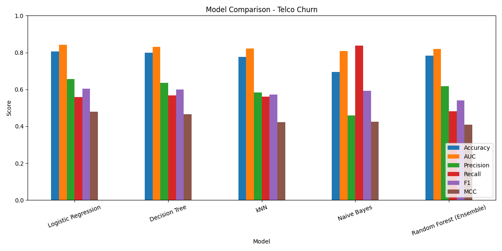

# ML Assignment 2 – Telco Customer Churn Classification

## a. Problem Statement
The goal is to predict whether a telecom customer will leave the company or not. This helps the company find such customers early and try to keep them.

## b. Dataset Description
- Source: Kaggle – Telco Customer Churn (blastchar)
- Rows: 7043, Columns: 21
- Target: Churn (Yes / No)
- Feature types: 3 numeric (tenure, MonthlyCharges, TotalCharges), SeniorCitizen (0/1), 15 categorical, customerID dropped
- Missing values: 11 in TotalCharges (blank spaces) – filled with median
- Duplicates: 0
- Class distribution: No = 5174 (73%), Yes = 1869 (27%) → imbalanced
- Why I chose it: It has more than 1000 rows and 12 features, and it is a simple Yes/No (binary) problem.

## c. GitHub Repository Link
https://github.com/samikshaasodekar/ML_Assignment_2

## Preprocessing
- Converted TotalCharges to numeric
- 80:20 stratified train-test split, random_state=42
- Numeric: median imputation + StandardScaler
- Categorical: most-frequent imputation + OneHotEncoder
- Pipeline used so preprocessing is fitted only on training data

## How to Run
pip install -r requirements.txt

Open churn_models.ipynb and run all cells.

## d. Models Used – Comparison Table

| ML Model Name | Accuracy | AUC | Precision | Recall | F1 | MCC |
|---|---|---|---|---|---|---|
| Logistic Regression | 0.806 | 0.842 | 0.657 | 0.559 | 0.604 | 0.479 |
| Decision Tree | 0.798 | 0.830 | 0.635 | 0.567 | 0.599 | 0.466 |
| kNN | 0.777 | 0.821 | 0.583 | 0.561 | 0.572 | 0.422 |
| Naive Bayes | 0.695 | 0.807 | 0.459 | 0.837 | 0.593 | 0.424 |
| Random Forest (Ensemble) | 0.784 | 0.819 | 0.619 | 0.481 | 0.541 | 0.408 |

## Observations

| ML Model Name | Observation |
|---|---|
| Logistic Regression | It performed the best on these data since it had the highest accuracy, AUC and MCC. |
| Decision Tree | Despite being a simpler model, Decision Tree's scores were quite similar to Logistic Regression. |
| kNN | The results of kNN were somewhat lower than those of Decision Tree and Logistic Regression. |
| Naive Bayes | Due to its low precision and high recall, it produced a lot of false alarms, but it was able to catch the majority of those who departed. |
| Random Forest (Ensemble) | Because Random Forest (Ensemble) had the lowest recall, it missed a lot of departing clients. |
| Overall Winner | Logistic Regression has the highest accuracy, AUC, and MCC, making it the best model for my dataset. |
